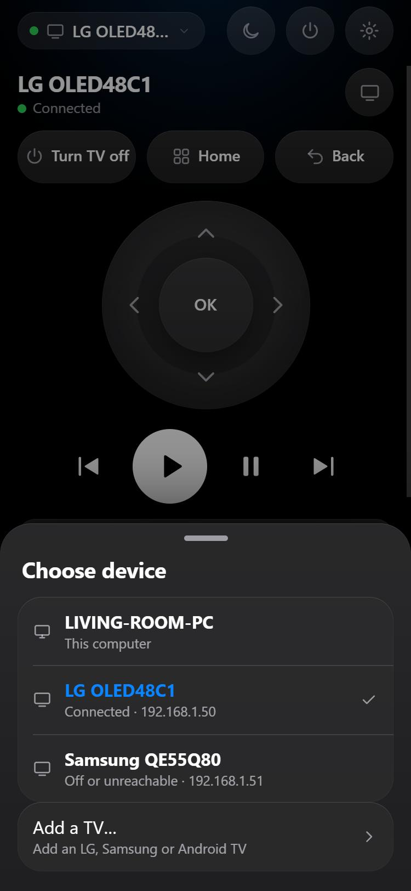
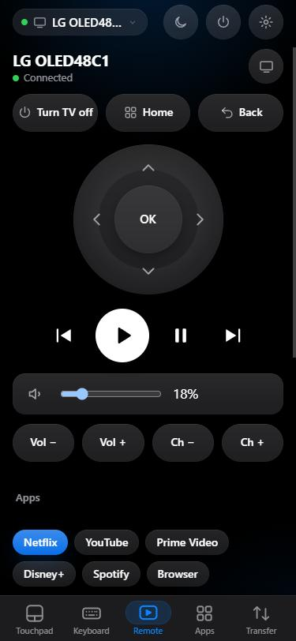
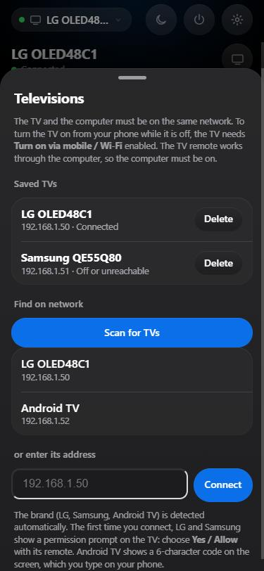
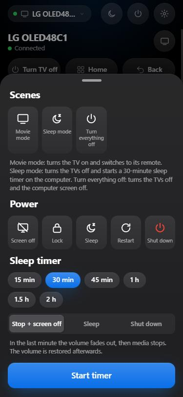

# CouchRemote installation guide

**English** · [Türkçe](KURULUM.md)

Turn your iPhone into a touchpad, keyboard and media remote for your PC. Control movies from bed, change the volume, move the cursor.

**You need:** a Windows 10/11 PC, an iPhone, both on the **same Wi-Fi** (or the PC on Ethernet and the phone on the same router).

## 1. Install on the PC (2 minutes)
1. Double-click `CouchRemote.exe`.
2. If Windows shows a "Windows protected your PC" (SmartScreen) warning: **More info → Run anyway**. (The file isn't code-signed yet, so this appears.)
3. Click **Yes** in the permission window. This only adds a firewall rule so your phone can connect from your local network.
4. The "Connect your phone" page opens. Keep it open.

## 2. Pair your iPhone (once)
1. Point the iPhone **Camera** at the QR code on the page and tap the link that appears.
2. Follow the steps in Safari: first **download the security profile**, then install it under **Settings → General → VPN & Device Management**. Finally turn on trust for "CouchRemote" under **Settings → General → About → Certificate Trust Settings**.
   The verification code on the page (e.g. `7F3A-91C2`) must match the one on your PC screen.
3. In Safari tap **Share → Add to Home Screen**.
4. Open the **Couch** icon on your Home Screen. Pairing happens automatically.

From now on you just open the app; it connects by itself.

## Using it
- **Touchpad:** one finger moves the cursor, tap = click, two fingers scroll, three fingers switch desktops.
- **Air mouse:** choose "Air mouse" on the Touchpad screen, hold and turn your phone to point.
- **Keyboard:** full on-screen keyboard, or type with the iPhone keyboard.
- **Remote:** play/pause, volume, app-specific buttons (YouTube, Netflix…).
- **Apps:** launch Netflix/YouTube/Spotify and Steam games from your phone.
- **Transfer:** send the clipboard and files between phone and PC, take a screenshot.
- **Televisions:** control LG, Samsung and Android/Google TV (experimental) from your phone. TVs are found automatically under Settings › Devices › Televisions. Tap the device name at the top left to switch between the computer and your TVs; the selected TV is driven by the Remote, Touchpad and Keyboard tabs. **Scenes** in the power menu (Movie mode, Sleep mode) and Siri shortcuts (`tv-off`, `tv-volup`…) work too.
- **iPad:** the layout adapts to larger screens.
- **Language:** follows your phone; change it in Settings → Language.

## Android phone (experimental)
If you use Android instead of iPhone: scan the QR code on the "Connect your phone" page. The page detects Android and shows 3 steps:
1. **Download the certificate** (the code in the file name must match the security code on the page).
2. **Install it:** Settings › Security & privacy › More security settings › Encryption & credentials › Install a certificate › CA certificate (menu names vary by brand; you can search for "certificate").
3. In Chrome choose **⋮ › Install app**.

Android sometimes can't resolve `couch-xxxx.local`; in that case the page automatically tries the LAN address (`https://192.168.x.x:47801`). Give the computer a fixed address (DHCP reservation in your router). Haptics use the phone's vibration motor. This path hasn't been widely tested on real Android devices yet; tell us if you get stuck.

## Open windows and new gestures
- **Apps › Open windows:** lists the computer's open windows. Tap to bring to front; **−** minimizes, **×** closes (the app asks about unsaved work itself).
- **Pinch:** spread or pinch two fingers on the touchpad to send Ctrl + wheel (zooms browsers and documents). Can be turned off in Settings › Touchpad.
- **Open a link on the TV:** in the TV remote, "Open link": YouTube links open the video, other links open in the TV's browser.

## Control your TV too
LG, Samsung and Android/Google TV (experimental) are supported. The computer connects to the TV and relays your commands, so the computer must be on and on the same network while you use the TV.

1. On your phone: **Settings › Devices › Televisions** (or tap the device name at the top left › **Add a TV…**). The network is scanned while the TV is on; tap the TV that appears. If it isn't found, type the TV's address. The brand is detected automatically.
2. The first time, the TV shows a question: choose **Yes / Allow** with its remote. Android TV shows a 6-character code on screen; type it on your phone.
3. Tap the device name at the top left to switch between the **computer** and your TVs. With a TV selected, the Remote, Touchpad and Keyboard tabs drive that TV.
4. **Scenes** in the power menu: *Movie mode* (turns the TV on and switches to its remote), *Sleep mode*, *Turn everything off*.

  
  
  
  

To turn a TV on from your phone while it is off, enable **Turn on via mobile / Wi-Fi** in the TV's settings. For Siri shortcuts use `tv-on`, `tv-off`, `tv-volup`, `tv-mute`… (Settings › Siri & Shortcuts).

## If your phone says it isn't registered / the computer was reset
- **Automatic backup:** the program keeps the last 5 copies of its settings file in `%LOCALAPPDATA%\CouchRemote\backup`. If the file is deleted or corrupted it recovers from the newest one by itself; phones keep working without setting up again. A notice appears on the admin page.
- **Password-protected backup (before reinstalling Windows):** "Connect your phone" page › Advanced › **Backup and recovery** › enter a password › **Back up**. On the new install use **Restore** in the same place: paired phones and the security certificate come back.
- **No backup:** on the phone open Settings › **Connection troubleshooter** (or "Troubleshooter" on the connection screen). It walks you through opening the setup page, deleting the old profile, installing the new one, and, if needed, resetting this phone's pairing and reconnecting with the PIN.
- The admin page shows a warning when an unregistered phone tries to connect.

## Troubleshooting
- **"Can't reach your computer":** the PC may be asleep; wake it and wait a few seconds. Check that both devices are on the same Wi-Fi.
- **It won't connect:** set the Windows network profile to **Private** (Settings → Network & internet → Wi-Fi/Ethernet → Properties). The "Connect your phone" page warns you and fixes it in one click.
- **Lost phone:** right-click the CouchRemote icon next to the clock → **Remove all phone pairings**.
- **Uninstall:** the same icon → **Uninstall…**, or Windows Settings → Apps.

Privacy: no data leaves your local network; everything is encrypted. See [SECURITY.en.md](SECURITY.en.md).
