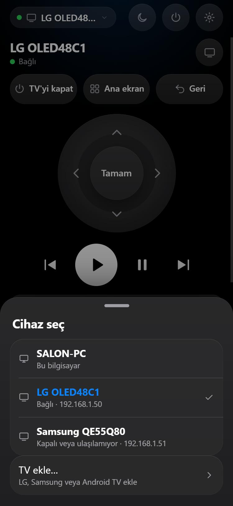
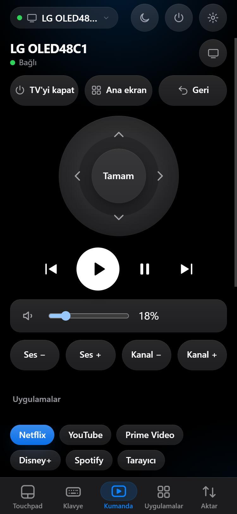
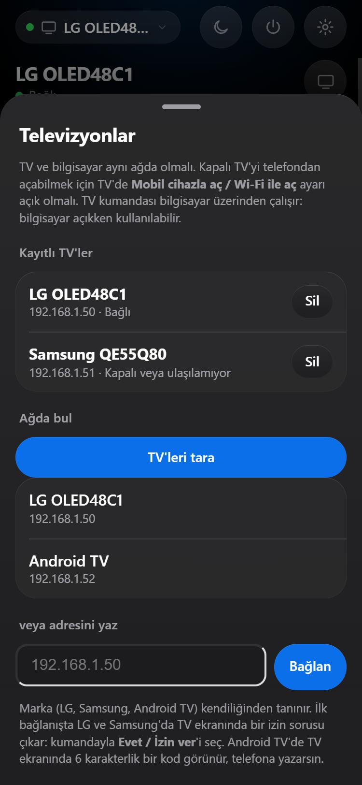
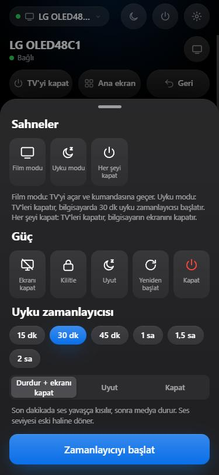

# CouchRemote kurulum rehberi

[English](INSTALL.md) · **Türkçe**

iPhone'unu bilgisayarın için touchpad, klavye ve TV kumandasına çevirir. Yataktan film aç, sesi kıs, imleci sür.

**Gerekenler:** Windows 10/11 bilgisayar, iPhone, ikisi de **aynı Wi-Fi** (veya bilgisayar kablolu, telefon aynı modemde).

## 1. Bilgisayara kur (2 dakika)
1. `CouchRemote.exe` dosyasını çift tıkla.
2. Windows "Bilgisayarınızı korudu" (SmartScreen) uyarısı çıkarsa: **Ek bilgi → Yine de çalıştır**. (Dosya henüz kod imzalı değil, bu yüzden çıkıyor.)
3. İzin penceresine **Evet** de. Bu izin sadece yerel ağdan telefonun bağlanabilmesi için.
4. "Telefonunu bağla" sayfası açılır. Bu sayfayı açık bırak.

## 2. iPhone'u bağla (bir kez)
1. iPhone'un **Kamera**'sıyla sayfadaki QR kodu okut, çıkan bağlantıya dokun.
2. Safari'de adımları izle: önce **güvenlik profilini indir**, sonra **Ayarlar → Genel → VPN ve Aygıt Yönetimi**'nden profili yükle. En sonda **Ayarlar → Genel → Hakkında → Sertifika Güven Ayarları**'ndan "CouchRemote" için güveni aç.
   Sayfadaki doğrulama kodu (ör. `7F3A-91C2`) bilgisayar ekranındakiyle aynı olmalı.
3. Safari'de **Paylaş → Ana Ekrana Ekle** de.
4. Ana ekrandaki **Couch** simgesinden aç. Eşleşme otomatik olur.

Bundan sonra uygulamayı açman yeterli; bağlantı kendiliğinden kurulur.

## Kullanım
- **Touchpad:** bir parmak imleç, dokun = tık, iki parmak kaydır, üç parmak masaüstü geçişi.
- **Hava faresi:** Touchpad ekranında "Hava faresi"ni seç, basılı tutup telefonu çevirerek işaret et.
- **Klavye:** ekranda tam klavye veya iPhone klavyesiyle yazı.
- **Kumanda:** oynat/duraklat, ses, uygulama özel düğmeleri (YouTube, Netflix...).
- **Uygulamalar:** Netflix/YouTube/Spotify ve Steam oyunlarını telefondan aç.
- **Aktar:** panoyu ve dosyaları telefon ↔ bilgisayar gönder, ekran görüntüsü al.
- **Televizyon:** LG, Samsung ve Android/Google TV (deneysel) telefondan kumanda edilir. Ayarlar › Cihazlar › Televizyonlar'dan TV'ler otomatik bulunur. Sol üstteki cihaz adına dokunup Bilgisayar ve TV'ler arasında geçersin; seçili TV'yi Kumanda, Touchpad ve Klavye sekmeleri sürer. Güç menüsündeki **Sahneler** (Film modu, Uyku modu) ve Siri kestirmeleri (`tv-off`, `tv-volup`…) de çalışır.
- **iPad:** geniş ekranda düzen kendiliğinden uyum sağlar.

## Android telefon (deneysel)
iPhone yerine Android kullanıyorsan: bilgisayardaki "Telefonu bağla" sayfasının QR kodunu okut. Sayfa Android'i tanır ve 3 adım gösterir:
1. **Sertifikayı indir** (dosya adındaki kod, sayfadaki güvenlik koduyla aynı olmalı).
2. **Sertifikayı yükle:** Ayarlar › Güvenlik ve gizlilik › Diğer güvenlik ayarları › Şifreleme ve kimlik bilgileri › Sertifika yükle › CA sertifikası (menü adları markaya göre değişir; "sertifika" diye aratabilirsin).
3. Chrome'da **⋮ › Uygulamayı yükle**.

Android bazen `couch-xxxx.local` adını çözemez; bu durumda sayfa LAN adresiyle (`https://192.168.x.x:47801`) kendiliğinden dener. Bilgisayarın adresi sabit olmalı (router'dan "adres ayır"). Titreşim Android'de telefonun titreşim motoruyla çalışır. Bu yol gerçek bir Android cihazla henüz yaygın denenmedi; takılırsan haber ver.

## Açık pencereler ve yeni jestler
- **Uygulamalar › Açık pencereler:** bilgisayarın açık pencerelerini listeler. Dokun: öne getir. Sağdaki **−** küçültür, **×** kapatır (uygulama kaydedilmemiş iş için kendi sorusunu sorar).
- **Pinch:** touchpad'de iki parmağı açıp kapat: Ctrl + tekerlek (tarayıcıda ve belgelerde yakınlaştırır). Ayarlar › Touchpad'den kapatılabilir.
- **TV'de link aç:** TV kumandasında "Link aç": YouTube linki videoyla, başka linkler TV'nin tarayıcısında açılır.

## Televizyonu da kumanda et
LG, Samsung ve Android/Google TV (deneysel) desteklenir. Bilgisayar, TV'ye bağlanıp aracılık eder; yani TV kullanılırken bilgisayar açık ve aynı ağda olmalı.

1. Telefonda **Ayarlar › Cihazlar › Televizyonlar** (veya sol üstteki cihaz adına dokun › **TV ekle…**). TV açıkken ağ taranır; bulunan TV'ye dokun. Bulunamazsa TV'nin adresini elle yaz. Marka kendiliğinden tanınır.
2. İlk bağlanışta TV ekranında bir soru çıkar: kumandayla **Evet / İzin ver**'i seç. Android TV'de TV ekranında 6 karakterlik bir kod görünür, telefona yaz.
3. Sol üstteki cihaz adına dokunup **Bilgisayar** ile TV'ler arasında geçiş yap. Bir TV seçiliyken Kumanda, Touchpad ve Klavye sekmeleri o TV'yi sürer.
4. Güç menüsündeki **Sahneler**: *Film modu* (TV'yi açıp kumandasına geçer), *Uyku modu*, *Her şeyi kapat*.

  
  
  
  

Kapalı TV'yi telefondan açmak için TV'de **Mobil cihazla aç / Wi-Fi ile aç** ayarı açık olmalı. Siri kestirmeleri için: `tv-on`, `tv-off`, `tv-volup`, `tv-mute`… (Ayarlar › Siri ve Kestirmeler).

## Telefon "kayıtlı değil" derse / bilgisayar sıfırlanırsa
- **Otomatik yedek:** program ayar dosyasının son 5 kopyasını `%LOCALAPPDATA%\CouchRemote\backup` klasörüne kaydeder. Dosya silinir ya da bozulursa en yenisinden kendiliğinden kurtarır; telefonlar yeniden kurulum yapmadan çalışır. Yönetim sayfasında bir bilgi çıkar.
- **Parolalı yedek (Windows'u yeniden kurmadan önce):** "Telefonu bağla" sayfası › Gelişmiş › **Yedek ve kurtarma** › parola yaz › **Yedek al**. Yeni kurulumda aynı bölümden **Geri yükle**: eşleşmiş telefonlar ve güvenlik sertifikası geri gelir.
- **Yedek yoksa:** telefonda Ayarlar › **Bağlantı sorun giderici** (veya bağlantı ekranındaki "Sorun giderici") adımları gösterir: kurulum sayfasını aç, eski profili sil, yenisini yükle, gerekirse bu telefonun eşleşmesini sıfırla ve PIN ile yeniden bağlan.
- Yönetim sayfası, kayıtlı olmayan bir telefon bağlanmaya çalıştığında bunu uyarı olarak gösterir.

## Sorun olursa
- **"Bilgisayara ulaşılamıyor":** bilgisayar uyku modunda olabilir; uyandırıp birkaç saniye bekle. İkisi de aynı Wi-Fi'de mi bak.
- **Bağlanmıyor:** Windows ağ profilini **Özel** yap (Ayarlar → Ağ ve internet → Wi-Fi/Ethernet → Özellikler → Özel). "Telefonunu bağla" sayfası bunu uyarır ve tek tıkla düzeltir.
- **Telefon kaybolursa:** saatin yanındaki CouchRemote simgesine sağ tıkla → **Tüm telefonların eşleşmesini kaldır**.
- **Kaldırmak için:** aynı simge → **Kaldır**, veya Windows Ayarlar → Uygulamalar.

Güvenlik: Hiçbir veri internete çıkmaz; her şey yerel ağda şifreli çalışır. Ayrıntılar için `SECURITY.md`.
